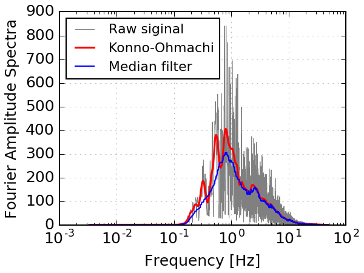

# _Fast_ Konno-Ohmachi

Konno-Ohmachi spectral smoothing for Python. The smoother is written in Rust and published as wheels for Linux, macOS, and Windows.

## Background

Konno-Ohmachi smoothing, from Konno & Ohmachi (1998) [[abstract](http://bssa.geoscienceworld.org/content/88/1/228.short), [PDF](http://www.eq.db.shibaura-it.ac.jp/papers/Konno&Ohmachi1998.pdf)], applies a window whose width is constant in log-frequency:

```text
w = (sin(b log10(f / fc)) / (b log10(f / fc)))^4
```

Low frequencies get a narrower window than high frequencies. Seismologists use that so the low-frequency part of a spectrum (below about 10 Hz) is not smeared out.

The plot below compares that window with a median filter on the Fourier amplitude spectrum of a ground acceleration recorded during the [2011 Tohoku-Oki earthquake](https://en.wikipedia.org/wiki/2011_T%C5%8Dhoku_earthquake_and_tsunami). Above about 5 Hz the two are similar. At lower frequencies the median filter flattens the spectrum.



## Installation

```bash
pip install fast-konno-ohmachi
```

Wheels are built for CPython 3.10 and newer (abi3), on Linux x86_64 and arm64, macOS arm64 and x86_64, and Windows x64 and arm64. Installing from a source checkout needs a Rust toolchain.

## Usage

```python
import numpy as np
import fast_konno_ohmachi as ko

freq = np.linspace(0.1, 20.0, 2000)
signal = np.sin(freq)

smoothed = ko.smooth(signal, freq, bandwidth=40)
```

`bandwidth` is the Konno-Ohmachi `b`. Lower values smooth more. The default is 40, and any positive finite number is allowed.

`freq` above is `freq_in`: the frequency of each input sample, in hertz. It has to be finite, positive, and strictly increasing. `freq_out` chooses where the smooth is written and defaults to `freq_in`. A shorter `freq_out` does less work.

```python
coarse = np.linspace(freq[0], freq[-1], 400)
smoothed = ko.smooth(signal, freq, bandwidth=40, freq_out=coarse)
```

`method="approx"` (the default) keeps frequencies with `|b log10(f / fc)| <= 3` and evaluates the window with a polynomial. If an output frequency has no input sample in that range, that one output uses the full exact window. `method="exact"` sums the published window over every positive frequency.

`n_cores` is how many cores to use. The default for `smooth` is 1. `None` uses every logical CPU available to the process, which under a container CPU quota can be fewer than the machine has, and a larger value raises `ValueError`. The workers are ordinary threads; they are not pinned to cores.

```python
smoothed = ko.smooth(signal, freq, bandwidth=40, n_cores=None)
```

When many spectra share a frequency grid, build the weights once and reuse them:

```python
weights = ko.PrecomputedWeights(freq, bandwidth=40)
first = weights.apply(signal, n_cores=1)

batch = np.vstack([signal, signal * 0.5])
many = weights.apply_many(batch)  # n_cores defaults to all logical CPUs
```

`PrecomputedWeights` is not callable. `dtype="float32"` (or `np.float32`) stores the cached weights in float32; the arrays returned by `apply` and `apply_many` stay float64. The attributes `freq_in`, `freq_out`, `bandwidth`, `method` and `dtype` read back the constructor arguments, and the object can be pickled or copied, which rebuilds the weights from them.

With `method="exact"`, `PrecomputedWeights` stores one weight per (input, output) pair: `len(freq_in) * len(freq_out) * 8` bytes, or 4 with `dtype="float32"`. When `freq_out` is `freq_in` (the default) the window is symmetric, so each pair is stored once, `n * (n - 1) / 2` weights for `n` frequencies: 0.9 GB for the 15000-point spectrum in `demo/`. Weights that do not fit raise `MemoryError`, and more than 2**32 - 1 of them raise `ValueError`. For a one-off exact smooth use `smooth(method="exact")`, which stores no weights.

On a log-uniform grid, with `method="approx"` and `freq_out` left as `freq_in`, both paths use a short convolution instead of a weight per output frequency.

`demo/Demo_konno_ohmachi_smooth.py` smooths the spectrum plotted above. Running it needs `scipy` and `matplotlib`.

## Benchmark against pykooh

[pykooh](https://github.com/arkottke/pykooh) 0.5.1 is another Konno-Ohmachi implementation, compiled with numba. The tables below time both libraries on the 15000-point Tohoku spectrum in `demo/` (a linear grid from 0.0033 to 50 Hz) with bandwidth 40. pykooh's `simplified=True` keeps the same `10**(±3/b)` range as `method="approx"` (the "cut window" rows), `simplified=False` sums over every frequency like `method="exact"`, and its `CachedSmoother` plays the role of `PrecomputedWeights(method="exact")`. pykooh has no cached form of the cut window.

Each time is the best of several runs, on a 4-vCPU x86_64 Linux VM with Python 3.13 and NumPy 2.5.4. The 1-CPU columns pin the whole process to one CPU with `taskset -c 0`, which also limits NumPy's BLAS; they are the per-core comparison. `fast-konno-ohmachi` runs with `n_cores=None` throughout.

Output at the 15000 input frequencies:

| Case | pykooh, 1 CPU | fast-konno-ohmachi, 1 CPU | pykooh, 4 CPUs | fast-konno-ohmachi, 4 CPUs |
|---|---|---|---|---|
| `smooth`, exact window | 7.08 s | 3.12 s | 7.25 s | 0.86 s |
| `smooth`, cut window | 1.26 s | 226 ms | 1.21 s | 65 ms |
| Exact weights: build | 35.3 s | 7.2 s | 35.2 s | 4.6 s |
| Exact weights: apply to 1 spectrum | 136 ms | 334 ms | 46 ms | 89 ms |
| Exact weights: apply to 64 spectra | 9.58 s | 22.2 s | 2.80 s | 5.56 s |
| Cut weights: build | n/a | 393 ms | n/a | 400 ms |
| Cut weights: apply to 64 spectra | n/a | 3.51 s | n/a | 882 ms |

Output at 419 log-spaced frequencies, 100 per decade:

| Case | pykooh, 1 CPU | fast-konno-ohmachi, 1 CPU | pykooh, 4 CPUs | fast-konno-ohmachi, 4 CPUs |
|---|---|---|---|---|
| `smooth`, exact window | 228 ms | 85 ms | 196 ms | 32 ms |
| `smooth`, cut window | 14.4 ms | 9.4 ms | 13.8 ms | 4.0 ms |
| Exact weights: build | 943 ms | 138 ms | 657 ms | 108 ms |
| Exact weights: apply to 1 spectrum | 4.5 ms | 9.7 ms | 2.0 ms | 4.5 ms |
| Exact weights: apply to 64 spectra | 293 ms | 608 ms | 116 ms | 159 ms |
| Cut weights: build | n/a | 7.5 ms | n/a | 6.5 ms |
| Cut weights: apply to 64 spectra | n/a | 39 ms | n/a | 10.6 ms |

- **One-shot smoothing** is 1.5 to 6 times faster on one CPU and up to 18 times faster on four, because pykooh's numba kernel runs on one thread.
- **Building exact weights** is 5 to 8 times faster. Builds run on one thread in both libraries. The 1.8 GB matrices make page faults a large, variable part of the build time on this VM, which is why the two `fast-konno-ohmachi` columns differ.
- **Applying exact weights is 1.4 to 2.5 times as fast in pykooh.** `CachedSmoother` stores a dense matrix and multiplies it with NumPy's BLAS, which is vectorized. `PrecomputedWeights` with the default cut window stores 6 times fewer weights (286 MB instead of 1.8 GB on the input grid) and applies them to 64 spectra in 3.51 s on one CPU, against 9.58 s for pykooh's dense exact weights.
- **Results agree** to within 4e-14 of the peak with the exact window and 3e-12 with the cut window. At 42 of the log-spaced outputs (43 with the cut window), all below 0.016 Hz, pykooh returns NaN because the window weights there sum to less than 0.3; `fast-konno-ohmachi` returns a value, falling back to the exact window where the cut window holds no sample.

`demo/benchmark_pykooh.py` reproduces these tables; it needs `pykooh` and `scipy`.

## Version 0.2

0.2 replaces the pure-Python implementation. `fast_konno_ohmachi`, `faster_konno_ohmachi`, and `slow_konno_ohmachi` are gone, along with `smooth_coeff`, `progress_bar`, and the even-integer limit on the bandwidth.

```python
# 0.1
smoothed = fast_konno_ohmachi(signal, freq, smooth_coeff=40, progress_bar=False)

# 0.2
smoothed = ko.smooth(signal, freq, bandwidth=40)
```
